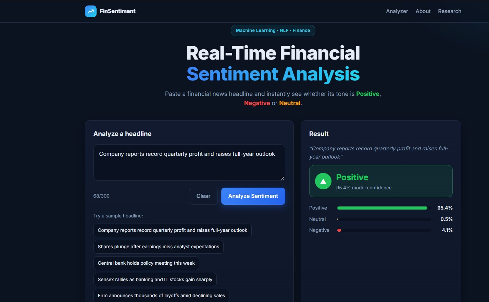
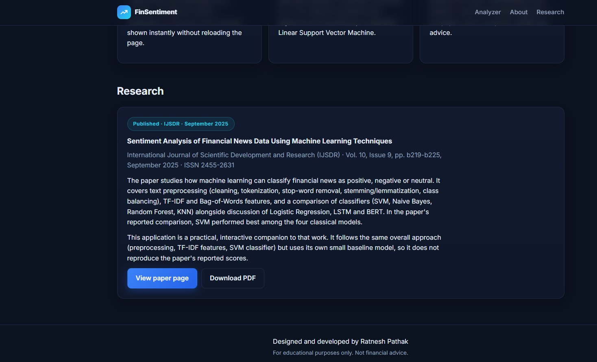
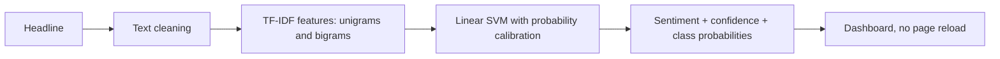

# Financial Sentiment Analysis Web App

**A clean, responsive web app that classifies a financial news headline as Positive, Negative or Neutral instantly, with no page reload.**
Type or pick a headline and see the predicted sentiment, a confidence score and a per-class probability breakdown.

> **This is a showcase repository.** The source code lives in a private repository. This page documents what the product does, how it is designed, and what I learned building it. Happy to walk through the code or a live demo on request.

> Educational project. Predictions come from a small baseline model and are not financial advice.

[**LinkedIn**](https://linkedin.com/in/ratnesh-pathak-087466279) | [**Email**](mailto:pathakratnesh03@gmail.com) | [**Research Paper**](https://ijsdr.org/viewpaperforall?paper=IJSDR2509129)

---

## Preview

---

## Overview

Financial markets react to news. This project turns that idea into a small interactive tool: type or pick a headline, click Analyze Sentiment, and see the predicted sentiment with a confidence score and a probability for each class.

## Features

- Modern, responsive financial dashboard UI for desktop and mobile
- Headline input with a character counter and one-click sample headlines
- Instant results without a page reload, with Positive / Negative / Neutral indicators and probability bars
- Recent analyses list for the current session
- About and Research sections with a link to the published paper
- Error handling for empty, overly long and invalid input

## How It Works

## Tech Stack

- **Backend:** Python, Flask
- **ML / NLP:** scikit-learn (TF-IDF + calibrated Linear SVM)
- **Frontend:** HTML, CSS, vanilla JavaScript
- No paid APIs or external services

## Research Paper

This app is a practical companion to my published paper, which compares SVM, Naive Bayes, Random Forest and KNN for financial news sentiment (SVM performed best among them).

*Sentiment Analysis of Financial News Data Using Machine Learning Techniques*, Dr. Santosh Kumar Singh, Amit Pandey, Mohit Singh, Ratnesh Pathak. International Journal of Scientific Development and Research (IJSDR), Vol. 10, Issue 9, September 2025. ISSN 2455-2631.

## Limitations (Honest Version)

- The app uses a lightweight baseline trained at start-up on about 150 hand-written headlines, not the model from the paper, so it does not reproduce the paper's reported scores
- No accuracy figure is claimed for this baseline, and predictions can be wrong on unusual wording
- Swapping in a larger labeled dataset improves it without code changes

## Related Project

This is an earlier, focused semester project. For the full platform, with market data, alerts, a REST API, analytics and reporting, see [FinSentAI](https://github.com/RatneshPathak/finsentai-showcase), my final project.

## Author

**Ratnesh Pathak** - M.Sc. Information Technology, AI / ML Engineer, Founder of Team Ignites

GitHub: [@RatneshPathak](https://github.com/RatneshPathak) | LinkedIn: [Ratnesh Pathak](https://linkedin.com/in/ratnesh-pathak-087466279) | Email: pathakratnesh03@gmail.com

---

(c) Ratnesh Pathak. All rights reserved. The text and images in this repository may not be reused without permission.
